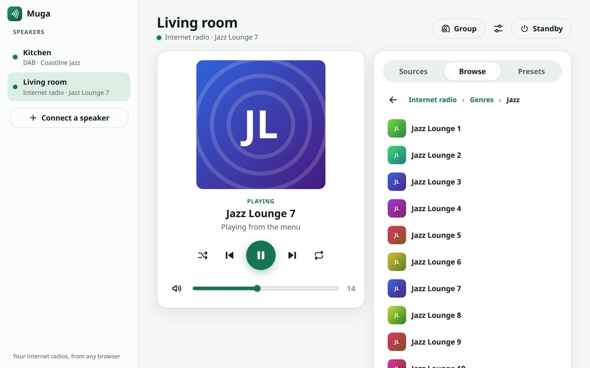
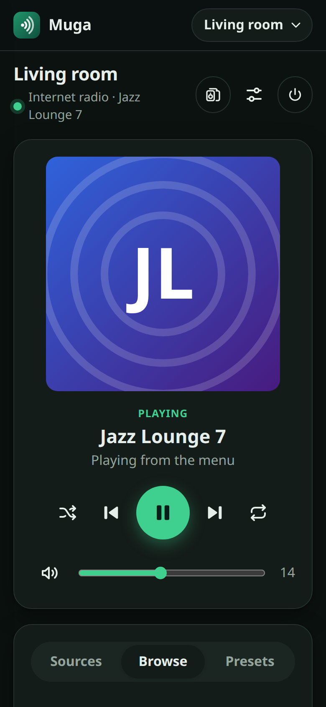
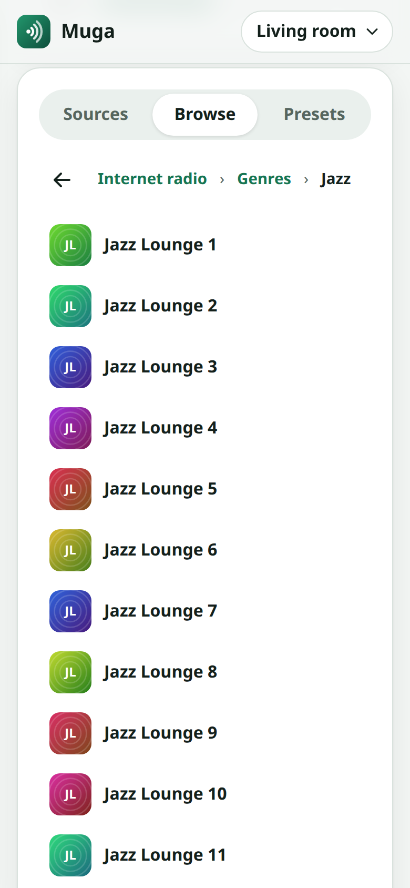
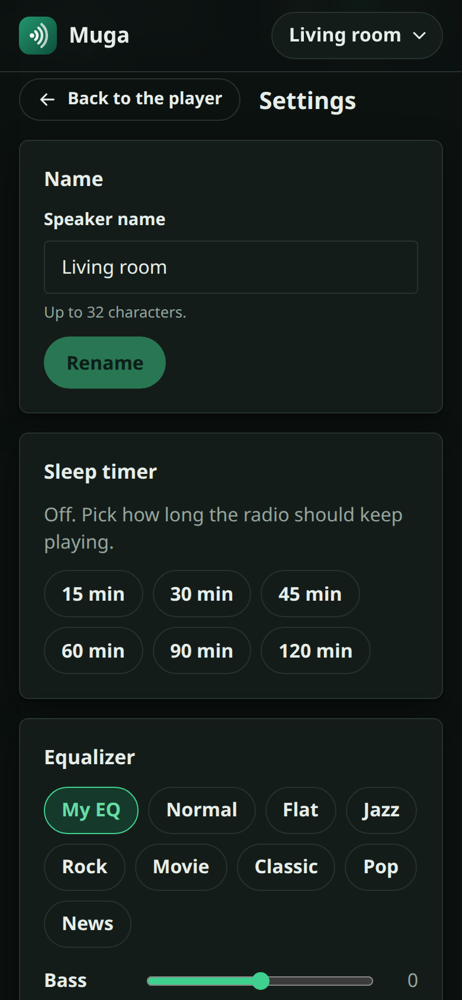

<p align="center">
  
</p>

<h1 align="center">Muga</h1>

<p align="center">
  <strong>📻 Your internet radios, from any browser.</strong><br>
  A web app for the Frontier Silicon radios that the UNDOK app controls:<br>
  Roberts, Ruark, Silvercrest, Eliteline, Hama, Medion and many more.
</p>

<p align="center">
  <a href="https://muga.calvellido.es/"></a>
  <a href="https://github.com/calvellido/muga/actions/workflows/ci.yml"></a>
  <a href="LICENSE"></a>
  
  
  
</p>

<p align="center">
  
</p>

*Muga* is Basque for "frontier".

Muga isn't affiliated with or endorsed by Frontier Smart or any radio vendor.

## ✨ What it does

- 🎵 **Now playing**, with artwork. Play, pause, stop, next, previous, shuffle and repeat, following what each radio supports.
- 🔊 **Volume, mute, standby.**
- 📡 **Sources**: internet radio, Spotify, DAB, FM, Bluetooth, AUX and whatever else your radio has.
- 🗂️ **Browse** each source's menu: folders, search and long lists, then tap to play.
- ⭐ **Presets**: recall them, save what's playing, delete and reorder (where the radio allows it).
- 📻 **FM tuner**: a dial, one-step buttons, and seek to the next station.
- 📶 **DAB scan**, with progress. Stations that can no longer be received are removed afterwards.
- 🏠 **Multiroom groups**: group speakers so they play the same thing in sync, with a group volume and a volume for each speaker. Add and remove speakers, rename, put the whole group in standby, or ungroup.
- 🔎 **Finds your speakers**: "Find speakers" looks for radios on your network, so there's no IP address to type. And when your router gives a speaker a new address, Muga finds it again.
- ⚙️ **Settings**: name, sleep timer, equalizer, the radio's own menu language, clock and time zone, streaming quality.
- ℹ️ **Device info**: model, firmware, network and Wi-Fi signal.
- 📱 **Phone and desktop**, light or dark, and it installs as an app.
- 🌍 **English and Spanish**: your browser's language, or the one you pick in Muga settings.
- 🔒 **No account, no cloud, no tracking.** Your browser talks straight to your radios on your own network.

<p align="center">
  
  
  
</p>

## 📲 Use it

1. Open **[muga.calvellido.es](https://muga.calvellido.es/)** in Chrome or Edge, on a computer or an Android phone.
2. Install it from the address bar or the browser menu.
3. Connect your first radio by its IP address and PIN, and allow local network access when the browser asks.

From then on the app works without the website. It talks straight to your radios on your network, and only checks the website for updates.

In Safari or Firefox, and on an iPhone or iPad, see [Where it works](#-where-it-works).

## 🧭 Where it works

| Browser | From muga.calvellido.es | Served at home over plain HTTP |
| --- | --- | --- |
| Chrome and Edge, on a computer or Android | ✅ Installs as an app | ✅ |
| Firefox | ⚠️ With a setting changed, see below | ✅ |
| Safari, and every browser on iPhone and iPad | ❌ Not yet | ✅ Add it to the home screen |

Radios answer over plain HTTP, and browsers block plain HTTP from secure (https) websites. Chrome and Edge make an exception for devices on your own network, once you allow it. Safari and Firefox are working towards the same. Until then, Muga tells you so, and you can serve it at home instead: see "On a phone at home" below. Details are in [ADR 0012](docs/adr/0012-browsers-without-local-network-access.md).

> [!CAUTION]
> **Firefox, if you accept the trade-off:** open `about:config`, set `security.mixed_content.block_active_content` to `false`, and allow local network access when Firefox asks. This turns off a protection for every website, not only Muga, so it's best kept to a separate Firefox profile used only for Muga (`about:profiles`). Muga may still say the browser can't reach your radios; you can ignore that.

## 🚀 Try it

You need Node 22 or later and pnpm 10. No radio is needed to try it: Muga ships with a simulated one.

```sh
pnpm install
pnpm sim     # terminal 1: a simulated radio on 127.0.0.1:8099
pnpm web     # terminal 2: open http://localhost:5173 and connect 127.0.0.1:8099
```

To try multiroom, run `pnpm sim --speakers 4` instead: four simulated speakers on ports 8099 to 8102 that can be grouped. Connect one of them and the others show up under "On your network".

**With your own radios:** connect each one by its IP address and PIN (usually `1234`). You'll find the IP address in the radio's network settings menu. The browser and the radios must be on the same network.

**As an installed app:** `pnpm web:build && pnpm web:preview`, then open http://localhost:4173 and install it from the browser.

**On a phone at home, iPhone included:** `pnpm web:build && pnpm web:preview --host` serves it on your network over plain HTTP. Open the address it prints on the phone, and add it to the home screen (on an iPhone: Share, then Add to Home Screen). It needs that computer to be on.

## 🧰 What's inside

| Package | What it is |
| --- | --- |
| [`apps/web`](apps/web) | The web app: an installable PWA (React) that talks to radios directly from the browser |
| [`packages/fsapi-core`](packages/fsapi-core) | Typed FSAPI ("netRemote") client for browsers and Node: requests, XML parsing, catalog-based validation, lists, menus, sessions and notifications |
| [`packages/fsapi-sim`](packages/fsapi-sim) | A simulated radio over HTTP, with menus, presets, FM, DAB and settings, and simulated homes of speakers that group, for tests and hardware-free development |
| [`apps/cli`](apps/cli) | `muga`, a command-line tool for poking at radios |
| [`data/node-catalog.json`](data/node-catalog.json) | 284 FSAPI nodes (paths, types, flags, enums, list fields), the source of the generated types |

## 🛠️ Development

```sh
pnpm check                           # codegen check, typecheck, lint and tests
pnpm muga info 127.0.0.1:8099        # …or a real radio: pnpm muga info <radio-ip>
pnpm muga get 127.0.0.1:8099 play.status
pnpm muga set 127.0.0.1:8099 sys.audio.volume 12
pnpm muga list 127.0.0.1:8099 sys.caps.validModes
pnpm muga browse 127.0.0.1:8099 2 0  # the current source's menu, after entering folders 2 then 0
pnpm muga groups 127.0.0.1:8099      # multiroom: every speaker on the network and its group
pnpm muga nodes multiroom            # search the catalog offline
pnpm muga --help
```

Using the library:

```ts
import { FsapiClient } from "@muga/fsapi-core";

const radio = new FsapiClient({ host: "192.0.2.10", pin: "1234" });
await radio.get("netRemote.play.status");          // "PLAYING" (typed enum name)
await radio.set("netRemote.play.control", "PAUSE"); // validated before sending
const modes = await radio.listAllItems("netRemote.sys.caps.validModes");
```

<details>
<summary><strong>How the node catalog works</strong></summary>

`data/node-catalog.json` holds protocol facts only. It was produced by `pnpm catalog:curate` from a private static analysis of the UNDOK app; the analysis itself isn't part of this repository. `pnpm gen` turns it into `packages/fsapi-core/src/generated/nodes.ts`, from which all value and list types are derived. Never edit the generated file: `pnpm check` fails when it's stale.

</details>

<details>
<summary><strong>Working with real radios</strong></summary>

- FSAPI is plain HTTP, with the PIN in the URL; the default PIN is `1234`. The radios answer with `Access-Control-Allow-Origin: *`, which is what makes a web app without a server possible ([ADR 0001](docs/adr/0001-hubless-direct-transport-first.md)).
- Browsing and presets move the radio's menu (`nav.state`, `nav.action.*`). That's harmless, but someone using the radio's own menu at the same time will see it jump, as with UNDOK.
- Plain GET/SET needs no session. `muga watch` and `NotificationSession` create the radio's **single** session, so other controllers (such as UNDOK) lose live updates while they run.
- Group changes are SETs on the group's lead speaker, and every speaker in the group follows them. `muga groups` only reads.
- Writes are checked against the catalog and refused locally if they're invalid. Don't point automated tests at real radios for factory reset, firmware updates or network settings.

</details>

Decisions are recorded in [`docs/adr`](docs/adr). Never commit the UNDOK APK, decompiled sources, firmware images or analysis evidence; `.gitignore` blocks `*.apk` and `*.isu.bin` as a safety net.

## 📻 Tested radios

Muga has been checked on these radios. Others with the same Frontier Silicon platform should work, with features shown only where a radio reports them.

| Radio | Firmware | Notes |
| --- | --- | --- |
| Eliteline ICD2018 | V2.13.21c | FM and DAB (FM can be shared with a group), Bluetooth as a source, clock and menu-language settings |
| Ruark MRx | V2.14.35 | TIDAL, Deezer and Amazon Music sources, Bluetooth as a source, equalizer with loudness, streaming quality |
| Silvercrest SMRS35A1 | V2.11.11 | Internet radio, Spotify, AUX in |
| Silvercrest SMRS30A1 | V2.11.11 | Internet radio, Spotify, AUX in |

## 🗺️ Roadmap

- ✅ Protocol core, simulator and command-line tool
- ✅ Web app: now playing, controls, volume, sources and presets
- ✅ Menu browsing, preset editing, FM tuner, DAB scan and settings
- ✅ Multiroom groups
- ✅ Published at [muga.calvellido.es](https://muga.calvellido.es/), installable in Chrome and Edge
- 🔜 Firmware updates and a carefully guarded factory reset
- ⏸️ Stereo pairs and Bluetooth settings, for radios that support them (none of the tested ones does)
- ⏳ Safari, Firefox and the iPhone from the website, once their browsers allow it
- 💭 A small hub on your network, for live updates, and the iPhone over HTTPS

## 🙏 Acknowledgements

These community projects documented FSAPI long before Muga:
[flammy/fsapi](https://github.com/flammy/fsapi),
[flammy/fsapi-remote](https://github.com/flammy/fsapi-remote),
[zhelev/python-fsapi](https://github.com/zhelev/python-fsapi),
[tiwilliam/fsapi](https://github.com/tiwilliam/fsapi),
[p2baron/fsapi](https://github.com/p2baron/fsapi) and
[dkuku/node-frontier-silicon](https://github.com/dkuku/node-frontier-silicon).

## 📜 Licence

[MIT](LICENSE)
